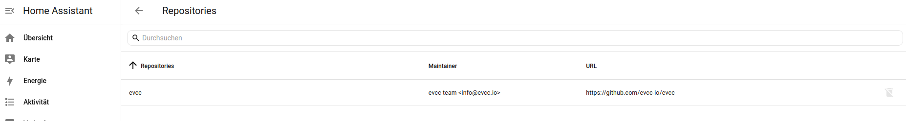
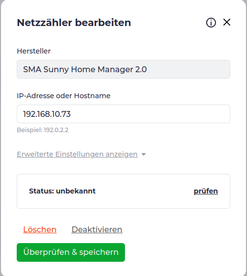
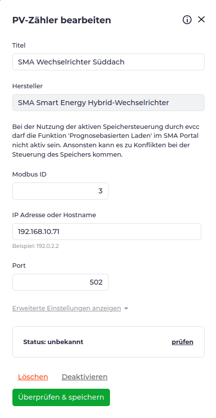
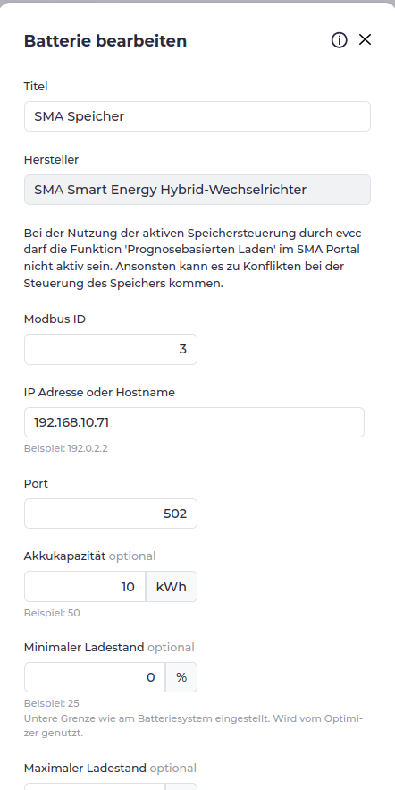
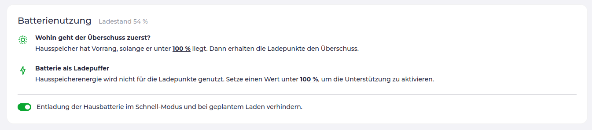
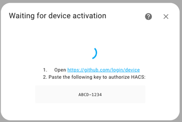
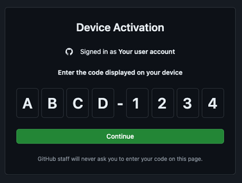
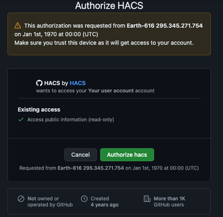

# Home Assistant

Klicke auf die drei Punkte → Repositories
Füge die Repository-URL ein und klicke auf Hinzufügen

https://github.com/evcc-io/hassio-addon



Nun evcc installieren.

## SSH installieren

SSH App installieren

## HTTPS

Schlüssel erzeugen (auf dem PC und auf den raspi kopieren):

    openssl req -sha256 -newkey rsa:4096 -nodes -keyout /ssl/homeassistant.key -x509 -days 3650 -out /ssl/homeassistant.crt

Zertifikat und Key per ssh auf das Target kopieren.

Nach dem Kopieren den ssh Port in der Konfiguration der ssh App wieder zurücksetzen, so dass ein Login nicht mehr möglich ist.

Nun muss das Zertifikat in den Netzwerkeinstellungen eingetragen werden.

## SMA Wechselrichter hinzufügen

Es muss immer der SMA Hybrid wechselrichter in der Liste ausgewählt werden.

Protokoll Modbus TCP auswählen (Port 502 ID 3)

### Batterie hinzufügen

Gleiche Einstellungen wie beim Wechselrichter

### Zähler hinzufügen









### Heizung hinzufügen

Negative Leistung.

Unter /app_configs/49686a9f_evcc/evcc.yaml folgende Datei abspeichern:

```
# 1. Virtuelles Meter zur Leistungssimulation
meters:
  - name: wp_virtuelles_meter
    type: custom
    power:
      source: http
      uri: http://192.168.10.86/rpc/Switch.GetStatus?id=0
      jq: 'if .output == true then 2000 else 0 end'


# 2. Anbindung der Hardware (Shelly Pro 1)
chargers:
  - name: shelly_heizung
    type: template
    template: shelly
    host: 192.168.10.86       # IP-Adresse deines Shelly Pro 1 anpassen
    #standbypower: -2000       # Negativer Wert = Statischer Modus (2 kW Nennleistung)

# 3. Steuerungslogik & Schutz vor Takten
loadpoints:
  - title: Tecalor Wärmepumpe
    charger: shelly_heizung
    meter: wp_virtuelles_meter  # Verknüpft das virtuelle Messgerät mit diesem Ladepunkt
    mode: pv                  # Startet automatisch im PV-Überschussmodus
    enable:
      threshold: -2200        # Schaltet ein, sobald mindestens 1.700 W Überschuss vorhanden sind
      delay: 20m               # Der Überschuss muss mindestens 20 Minuten stabil anliegen
    disable:
      threshold: -100          # Löst den Ausschalt-Timer wenn weniger als  100 W eingespeist werden 
      delay: 30m              # Mindestnachlaufzeit / Verzögerung: 30 Minuten
```

## HACS

`https://github.com/hacs/addons` als repo hinzufügen

- Nun die App HACS installieren und starten

- Neustart von Home assistant

- Unter Dienste und Geräte -> Integration hinzufügen

- HACS hinzufügen

- Alle Häkchen anklicken

- Dem Link im Dialogfenster folgen (Login in github mit eigenem User)



- Im folgenden Dialog den Code eingeben.





Nähere Informationen zum HACS Setup siehe: https://hacs.xyz/docs/use/configuration/basic/#to-set-up-the-hacs-integration

### EVCC Integration

- In der Seitenleiste HACS wählen

- nach *evcc - Solar Charging by marq24* suchen

- Die Integration herunterladen
